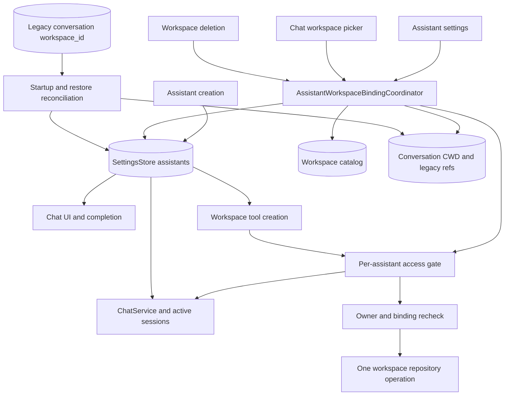
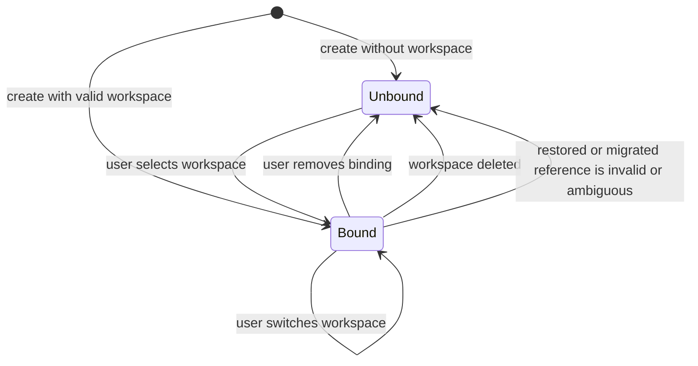

# Assistant-Level Workspace Binding - Plan

## Goal Capsule

- **Objective:** A workspace selection remains attached to an assistant across all of that assistant's conversations until the user switches or removes the binding.
- **Means:** Make `Assistant.workspaceId` the only active binding source, migrate legacy conversation bindings conservatively, and keep conversation workspace data only as a temporary compatibility input (KTD1, KTD2).
- **Authority:** Product Requirements and session-settled Product Decisions override technical choices; Key Technical Decisions govern implementation details.
- **Execution profile:** Cross-store migration and behavior fix spanning DataStore, Room, chat runtime, workspace tools, UI, and portable workspace archives.
- **Stop conditions:** Stop implementation if a valid existing assistant binding cannot be distinguished from a legacy conversation binding, or if archive restore cannot run reconciliation before restored conversations become usable.

---

## Product Contract

### Summary

Workspace selection becomes durable assistant state rather than a value copied into each conversation. Creation, later binding, switching, unbinding, deletion, migration, and archive restore all converge on the same assistant-level behavior.

### Problem Frame

`Assistant.workspaceId` already exists, but chat selection, completion, generation, workspace tools, and message rendering primarily use `Conversation.workspaceId`. New conversations copy the assistant value once, while existing conversations keep their own value. This creates two competing sources and makes a binding appear to disappear when the user changes conversations.

The fix must remove that split without guessing when historical conversations for the same assistant disagree. It must also prevent a stale conversation working directory or an already-created tool from continuing to use a workspace after the user changes the assistant binding.

### Key Decisions

- **Workspace ownership is assistant-level** (session-settled: user-directed — chosen over conversation-level ownership: a selected workspace must survive conversation changes). Governs R1-R6.
- **An initially unbound assistant can be bound later from chat or assistant settings** (session-settled: user-approved — chosen over creation-only binding: the user confirmed both creation paths must remain complete). Governs R2, R3.
- **Ambiguous legacy data remains unbound** (session-settled: user-approved — chosen over selecting the newest or most frequent conversation value: the user approved a no-guess migration). Governs R7.

### Requirements

**Binding lifecycle**

- R1. Creating an assistant with a selected workspace persists that workspace on the assistant and makes it available in every conversation owned by that assistant.
- R2. Creating an assistant with no workspace leaves it unbound until the user explicitly selects a workspace later.
- R3. Selecting a workspace later from chat or assistant settings updates the assistant binding and applies to all conversations owned by that assistant.
- R4. Switching or removing a binding updates only the selected assistant and is reflected across that assistant's open and future conversations.
- R5. Deleting a workspace clears every assistant binding that points to it and leaves unrelated assistants unchanged.
- R6. Moving a conversation to another assistant makes it use the destination assistant's binding; it does not carry its former assistant's workspace identity.

**Runtime and safety**

- R7. UI display, file completion, prompt context, generation, workspace tools, and edited-file rendering resolve the active workspace by exact `conversation.assistantId` lookup; a missing assistant fails closed as unbound and never falls back to the currently selected assistant.
- R8. A conversation working directory remains conversation-specific, but any assistant binding change, unbind, workspace deletion, or move between assistants clears both persisted and in-memory working directories that could belong to the previous workspace.
- R9. A workspace operation revalidates both the conversation owner and assistant binding at one serialized operation boundary. Binding changes and conversation moves invalidate in-flight generation so a stale captured capability cannot begin another operation after the change completes.
- R10. AI tools may consume the current assistant binding but may not create, switch, or remove an assistant binding.

**Migration and compatibility**

- R11. Migration preserves an existing assistant binding only when it references an existing workspace; otherwise it examines valid legacy conversation bindings for that assistant.
- R12. An unbound assistant with exactly one distinct valid legacy conversation workspace is bound to that workspace; zero or multiple distinct valid values leave it unbound.
- R13. Migration clears consumed legacy conversation references. It preserves a row's CWD only when that row's valid legacy workspace equals the assistant's final binding; missing, invalid, conflicting, orphan-assistant, or unbound rows lose their CWD.
- R14. Migration is idempotent, safe to resume after interruption, reads successfully decoded persisted Settings through a fail-fast API, and runs synchronously before chat is available at normal startup and after a full-restore process restart.
- R15. New archives treat assistant references as authoritative, while old archives with conversation references remain restorable and are normalized before use.

**Interaction reliability**

- R16. Binding controls expose loading, success, failure, and stale-submission states; they do not display a new binding until it is committed, and they require retry when another view changed the binding first.

### Acceptance Examples

- AE1. **Create bound assistant**
  - **Given:** Workspace A exists.
  - **When:** The user creates Assistant One and selects Workspace A.
  - **Then:** Every conversation under Assistant One shows and uses Workspace A.
  - **Covers:** R1, R7.
- AE2. **Bind after unbound creation**
  - **Given:** Assistant One was created with no workspace.
  - **When:** The user selects Workspace A from any Assistant One conversation.
  - **Then:** Assistant One becomes bound to Workspace A, and another Assistant One conversation immediately resolves Workspace A.
  - **Covers:** R2-R4.
- AE3. **Switch without cross-assistant leakage**
  - **Given:** Assistant One uses Workspace A and Assistant Two uses Workspace B.
  - **When:** The user switches Assistant One to Workspace C.
  - **Then:** Assistant One conversations use Workspace C, their stale working directories are cleared, and Assistant Two still uses Workspace B.
  - **Covers:** R4, R8.
- AE4. **Cancel binding**
  - **Given:** Assistant One is bound and has several conversations.
  - **When:** The user selects no workspace.
  - **Then:** All Assistant One conversations become unbound and no workspace tools are offered.
  - **Covers:** R4, R7-R10.
- AE5. **Conservative upgrade**
  - **Given:** One legacy assistant has conversations bound only to Workspace A and another has conversations bound to both Workspace A and Workspace B.
  - **When:** Reconciliation runs.
  - **Then:** The first assistant binds to Workspace A, the second remains unbound, and neither retains active conversation-level workspace references.
  - **Covers:** R11-R14.
- AE6. **Binding changes during generation**
  - **Given:** A generation for Assistant One captured Workspace A.
  - **When:** The user switches Assistant One to Workspace B before the next tool operation.
  - **Then:** The old generation is stopped or the operation is rejected, and no later operation accesses Workspace A after the switch completes.
  - **Covers:** R9.
- AE7. **Concurrent views submit different bindings**
  - **Given:** Two open conversations both displayed Assistant One bound to Workspace A.
  - **When:** One commits Workspace B and the stale view then submits Workspace C with A as its expected value.
  - **Then:** Workspace B remains authoritative, the stale submission reports a conflict, and the stale view refreshes before the user retries.
  - **Covers:** R4, R16.

### Scope Boundaries

- Keep `workspaceCwd` conversation-specific; this change does not create an assistant-wide current directory.
- Do not give the model a tool for changing assistant workspace bindings.
- Do not delete the Room `workspace_id` column in the first release. It remains a legacy import field but is excluded from active domain state.
- Do not redesign workspace permissions, shell isolation, snapshots, or audit semantics.
- Assistant cloning continues to copy the source assistant's binding because the clone is a new assistant with an explicit initial state; later changes remain independent.

---

## Planning Contract

### Key Technical Decisions

- KTD1. **Use `Assistant.workspaceId` as the only runtime binding source.** Remove `workspaceId` from active `Conversation` behavior and stop copying, editing, rendering, or passing it as a conversation-owned value. Resolve the assistant by `conversation.assistantId` at each UI and generation boundary.
- KTD2. **Keep the Room column for one compatibility cycle.** `ConversationEntity.workspaceId` and archive conversation references remain readable for migration and old backups, but normal conversation writes store `NULL` and repository mapping does not expose the value as active state. This avoids an unnecessary Room version bump while removing the dual source.
- KTD3. **Centralize and compare binding mutations.** Add an `AssistantWorkspaceBindingCoordinator` backed by `SettingsStore`, `WorkspaceDAO`, and `ConversationDAO`. Every operation carries the binding value the caller observed and applies only if that value is still current. A shared workspace-catalog mutation lock spans creation validation through assistant commit and spans workspace deletion through binding cleanup, so a not-yet-created assistant cannot race deletion.
- KTD4. **Eliminate runtime full-snapshot Settings writes.** Add a SettingsStore-level serialized transform that reads and mutates the latest persisted state while holding one shared write lock. Remove or make private the ordinary runtime `update(Settings)` API and convert every runtime caller to a field-level transform. Archive restore gets a separate authoritative replace API that is legal only inside the quiesced restore path and cannot race normal UI writers.
- KTD5. **Fail fast when persisted Settings cannot be read.** Add an initialization read API that does not convert DataStore I/O or decode failures into empty settings. Startup reconciliation uses that API and blocks normal startup on failure; normal UI flows may keep their existing resilient display flow after initialization succeeds.
- KTD6. **Give CWD a dedicated persistence path.** Ordinary conversation saves preserve the database's current CWD and cannot write a CWD from a stale `Conversation` snapshot. CWD selection, binding cleanup, and conversation transfer use targeted DAO updates plus synchronized in-memory session updates.
- KTD7. **Order cross-store changes for safe failure.** For a user binding change, invalidate affected sessions and clear CWD before updating DataStore; a crash can lose a directory preference but cannot run the old directory under a new workspace. For migration, update assistant settings before clearing legacy Room references; a crash then causes harmless reprocessing rather than loss of the only migration input.
- KTD8. **Use consumptive, idempotent reconciliation instead of a fragile version flag.** Reconciliation reads fail-fast persisted Settings, preserves valid assistant bindings, derives only a single valid legacy value for otherwise unbound assistants, clears unsafe rows according to R13, and removes orphan-assistant references. Once consumed, repeated runs make no further changes.
- KTD9. **Treat binding and ownership changes as capability revocation.** Workspace operations and binding mutations share a per-assistant access gate. A tool holds the gate across its complete invocation, including edit read-modify-write, exports, long-output persistence, and every repository access. It validates exact conversation ownership and binding before entering. Conversation transfer cancels and awaits that session, then changes ownership under the same boundary. When a binding mutation returns, no new operation using the old capability can start.
- KTD10. **Define one lock order.** Operations acquire the workspace-catalog mutation lock, then assistant access gates in stable assistant-ID order, then workspace repository/archive locks. Incremental import releases workspace locks before reconciliation. Full-restore startup has no active UI or tools and reconciles before exposing them.
- KTD11. **Split archive recovery by process lifetime.** Incremental imports that keep Room open reconcile after releasing workspace locks and before reporting success; compensation can restore both stores. Full database replacement keeps legacy inputs intact, exits, and reconciles synchronously in the next process after pre-Koin recovery, Koin startup, and pending snapshot recovery; reconciliation failure blocks normal app startup rather than claiming a rollback in the closed process.
- KTD12. **Model binding controls as committed-state interactions.** Selectors show the authoritative value until commit succeeds, disable duplicate submission while pending, report validation or stale-value failures with retry, and refresh or close when the workspace disappears. Workspace loading failure is distinct from the user's explicit unbound choice.

### High-Level Technical Design

#### Component and data flow

#### Binding state transitions

### System-Wide Impact

- **Data lifecycle:** The authoritative value remains in serialized assistant settings, while Room retains only a temporary legacy input and per-conversation CWD.
- **Open sessions:** Multiple active conversations can observe one assistant binding. Binding changes and conversation transfer both revoke stale sessions; operation gating prevents check-then-use races.
- **Conversation transfer:** Moving a conversation cancels and awaits its active session, clears CWD, changes ownership, and therefore adopts the destination assistant's binding.
- **Portable archives:** Settings and Room are restored as a pair. Full database replacement reconciles in the restarted process before activities can initialize chat; incremental import reconciles before returning success.
- **Workspace deletion:** Existing catalog locking must still prevent an archive from capturing a deleted workspace with live assistant references.
- **Agent boundary:** The model receives context and tools for the current binding but cannot alter the user's durable authorization choice.

### Risks and Mitigations

- **Cross-store partial failure:** DataStore and Room cannot share one transaction. Use KTD7 ordering, consume migration inputs only after settings persist, and make reconciliation repeatable.
- **Stale in-memory session or delayed save:** Conversation snapshots can outlive a binding update. Use dedicated CWD updates, preserve database CWD during ordinary saves, and clear session state through ChatService.
- **Already-running workspace operation:** Revocation cannot undo a native operation that has already crossed the access gate. The binding UI remains pending until the complete invocation exits; after commit returns, no old operation can start.
- **Restore bypasses current-process Room:** Full replacement closes Room and exits. Reconcile in the next process and block activity/chat startup on failure.
- **Settings read failure:** Resilient UI flows may synthesize defaults after an I/O error, but migration may not. The fail-fast initialization API distinguishes unreadable data from a real empty installation.
- **Invalid or orphan references:** Validate every assistant and legacy workspace ID against the catalog; exact assistant lookup failure is unbound and never uses the current assistant as fallback.
- **Concurrent Settings writes:** Serializing stale snapshots is insufficient. Remove runtime full-snapshot replacement and force all runtime writers through locked latest-state transforms.
- **Lock inversion:** Enforce KTD10 across tool, delete, and archive paths; run incremental reconciliation only after workspace locks are released.
- **Regression to dual writes:** Tests must assert that new and updated conversations persist `workspace_id` as `NULL`.

### Sequencing

U1 establishes the coordinator and migration primitives. U2 changes runtime resolution and revocation. U3 moves all user-facing mutation paths to the coordinator. U4 updates destructive and archive lifecycle paths. Each unit includes its own regression coverage before the next layer depends on it.

---

## Implementation Units

### U1. Add the assistant binding coordinator and legacy reconciliation

- **Goal:** Create one tested owner for assistant workspace mutation, CWD invalidation, and legacy conversation-binding migration.
- **Requirements:** R3-R5, R8, R11-R14, R16.
- **Dependencies:** None.
- **Files:**
  - `app/src/main/java/me/rerere/rikkahub/data/datastore/PreferencesStore.kt`
  - `app/src/main/java/me/rerere/rikkahub/ui/pages/translator/TranslatorVM.kt`
  - `app/src/main/java/me/rerere/rikkahub/ui/pages/extensions/PromptVM.kt`
  - `app/src/main/java/me/rerere/rikkahub/ui/pages/debug/DebugVM.kt`
  - `app/src/main/java/me/rerere/rikkahub/ui/pages/setting/SettingVM.kt`
  - `app/src/main/java/me/rerere/rikkahub/ui/pages/backup/BackupVM.kt`
  - `app/src/main/java/me/rerere/rikkahub/data/workspace/WorkspaceCatalogMutationLock.kt` (new)
  - `app/src/main/java/me/rerere/rikkahub/data/workspace/AssistantWorkspaceBindingCoordinator.kt` (new)
  - `app/src/main/java/me/rerere/rikkahub/data/db/dao/ConversationDAO.kt`
  - `app/src/main/java/me/rerere/rikkahub/data/db/entity/ConversationWorkspaceReference.kt`
  - `app/src/main/java/me/rerere/rikkahub/di/DataSourceModule.kt`
  - `app/src/main/java/me/rerere/rikkahub/RikkaHubApp.kt`
  - `app/src/androidTest/java/me/rerere/rikkahub/data/workspace/AssistantWorkspaceBindingCoordinatorTest.kt` (new)
  - `app/src/test/java/me/rerere/rikkahub/data/datastore/SettingsStoreConcurrencyTest.kt` (new)
- **Approach:**
  1. Add DAO projections grouped by `assistant_id`, targeted CWD updates, and legacy-reference cleanup that can compare each row's old workspace with the assistant's final binding.
  2. Replace runtime full-Settings writes with a shared locked latest-state transform. Keep authoritative replacement private to restore code and convert every compile-time caller of the removed public API.
  3. Add a fail-fast persisted Settings reader for startup migration; I/O or decode failure aborts startup instead of producing empty settings.
  4. Add coordinator operations for create, set, switch, unbind, deleted-workspace cleanup, startup reconciliation, and incremental-import reconciliation. Each user mutation includes its expected current binding.
  5. Share a catalog mutation lock between create validation-through-commit and workspace deletion-through-cleanup, and apply the global lock order from KTD10.
  6. Validate target and legacy IDs against `WorkspaceDAO`; preserve an existing valid assistant binding before considering conversation data, and fail closed for orphan assistants.
  7. Apply KTD7 ordering and serialize coordinator operations with the same per-assistant access gate used by workspace operations.
  8. Run reconciliation synchronously after Koin and pending workspace recovery are ready, using fail-fast Settings before integrity checks and activity/chat initialization.
- **Patterns to follow:** `WorkspaceRepository.delete` catalog locking, `RikkaHubApp` post-Koin recovery ordering, and Room DAO projection types.
- **Test scenarios:**
  1. Covers AE5. An unbound assistant with repeated references to one valid workspace becomes bound once and legacy references are cleared.
  2. Covers AE5. An unbound assistant with two distinct valid references remains unbound and its legacy references and CWD values are cleared.
  3. An assistant with a valid existing binding keeps it when matching legacy rows agree; conflicting, invalid, empty, and orphan rows lose CWD before all legacy references are consumed.
  4. An invalid existing binding with exactly one different valid legacy workspace adopts that valid workspace; invalid-only input remains unbound.
  5. Running reconciliation twice produces the same settings and database state as running it once.
  6. A simulated failure after settings update but before legacy cleanup succeeds on retry without choosing a different workspace.
  7. Setting one assistant's binding clears only that assistant's CWD rows and leaves another assistant untouched.
  8. Concurrent binding and an unrelated stale full Settings snapshot cannot lose either change because runtime full-snapshot replacement is unavailable.
  9. Delayed DataStore emission waits; DataStore I/O and decode failures block startup instead of looking like an empty installation.
  10. A latch-controlled delete between create validation and commit cannot create an assistant bound to the deleted workspace.
- **Verification:** Coordinator tests prove deterministic migration, failure ordering, assistant isolation, and idempotence against real Room tables.

### U2. Remove conversation binding authority from chat and tools

- **Goal:** Make every runtime consumer resolve the workspace from the owning assistant and revoke stale access after a binding change.
- **Requirements:** R4, R6-R10.
- **Dependencies:** U1.
- **Files:**
  - `app/src/main/java/me/rerere/rikkahub/data/model/Conversation.kt`
  - `app/src/main/java/me/rerere/rikkahub/data/db/entity/ConversationEntity.kt`
  - `app/src/main/java/me/rerere/rikkahub/data/repository/ConversationRepository.kt`
  - `app/src/main/java/me/rerere/rikkahub/service/ChatService.kt`
  - `app/src/main/java/me/rerere/rikkahub/service/ConversationSession.kt`
  - `app/src/main/java/me/rerere/rikkahub/data/ai/tools/WorkspaceTools.kt`
  - `app/src/main/java/me/rerere/rikkahub/data/ai/GenerationHandler.kt`
  - `app/src/main/java/me/rerere/rikkahub/ui/pages/chat/ChatPage.kt`
  - `app/src/main/java/me/rerere/rikkahub/ui/pages/chat/ChatList.kt`
  - `app/src/main/java/me/rerere/rikkahub/ui/components/message/ChatMessage.kt`
  - `app/src/main/java/me/rerere/rikkahub/ui/components/message/ChatMessageEditedFiles.kt`
  - `app/src/test/java/me/rerere/rikkahub/service/ChatServiceTest.kt`
  - `app/src/test/java/me/rerere/rikkahub/data/model/ConversationWorkspaceTest.kt`
  - `app/src/test/java/me/rerere/rikkahub/data/ai/tools/WorkspaceToolsTest.kt`
- **Approach:**
  1. Remove active `Conversation.workspaceId`, `withWorkspaceId`, initialization copying, and repository change detection based on conversation workspace.
  2. Keep the entity column nullable, always write it as `NULL`, ignore it in normal domain mapping, and load `workspaceCwd` independently.
  3. Move CWD persistence to targeted DAO methods. Ordinary message, title, and session saves preserve the current database CWD instead of copying one from an in-memory conversation snapshot.
  4. Resolve the assistant by exact `conversation.assistantId` match immediately before building completion providers, generation context, reminders, edited-file views, and workspace tools; missing assistants return no workspace capability.
  5. Make `ChatService` clear affected in-memory CWD and cancel and await session jobs for binding changes or conversation transfer.
  6. Route complete tool invocations through the shared access gate, including edit read-modify-write, file export, shell dispatch, and `GenerationHandler` long-output persistence.
  7. Move a conversation only after revocation completes, then clear CWD and persist the new owner; the destination assistant binding is resolved on the next render or generation.
- **Execution note:** Add characterization tests for current initialization and tool creation before replacing the conversation-owned path.
- **Patterns to follow:** Existing assistant lookup in `ChatService.sendMessage`, assistant-scoped conversation tools, and current workspace tool factory boundaries.
- **Test scenarios:**
  1. Covers AE1. New and existing conversations under a bound assistant resolve the same assistant workspace without persisting a conversation workspace ID.
  2. Covers AE4. An unbound assistant receives no workspace completion provider, reminder, or tools.
  3. Covers AE6. A tool created for Workspace A rejects execution after the assistant changes to Workspace B, including controlled races during edit read-modify-write, export, shell dispatch, and long-output persistence.
  4. Covers AE6. Changing a binding cancels and awaits active sessions for the affected assistant but not sessions owned by another assistant.
  5. Moving a conversation from Assistant One to Assistant Two during generation rejects the old tool, clears persisted and in-memory CWD, and makes later generation use Assistant Two's binding.
  6. A conversation whose assistant no longer exists is unbound in UI, completion, generation, and tools; it never receives the current assistant's workspace.
  7. A stale conversation save after CWD cleanup cannot restore the cleared CWD; saving and reloading under an unchanged binding still preserves a targeted CWD update.
  8. Edited-file rendering uses the current assistant workspace and handles a now-unbound assistant without accessing a legacy path.
- **Verification:** Unit tests prove one runtime source, assistant isolation, stale-tool rejection, and null legacy writes; chat rendering and Android test compilation prove updated call sites are complete.

### U3. Route creation, settings, and chat selection through assistant binding

- **Goal:** Expose the confirmed binding lifecycle consistently in assistant creation, assistant settings, and every conversation.
- **Requirements:** R1-R4, R10, R16.
- **Dependencies:** U1, U2.
- **Files:**
  - `app/src/main/java/me/rerere/rikkahub/ui/pages/assistant/AssistantPage.kt`
  - `app/src/main/java/me/rerere/rikkahub/ui/pages/assistant/AssistantVM.kt`
  - `app/src/main/java/me/rerere/rikkahub/ui/pages/assistant/detail/AssistantBasicPage.kt`
  - `app/src/main/java/me/rerere/rikkahub/ui/pages/assistant/detail/AssistantDetailVM.kt`
  - `app/src/main/java/me/rerere/rikkahub/ui/components/ai/FilesPicker.kt`
  - `app/src/main/java/me/rerere/rikkahub/ui/pages/chat/ChatVM.kt`
  - `app/src/test/java/me/rerere/rikkahub/ui/pages/assistant/AssistantWorkspaceBindingViewModelTest.kt` (new)
- **Approach:**
  1. Expose loading, error, empty, and content states for the workspace catalog in the assistant creation sheet, and reuse the existing nullable selector only in the content state.
  2. Let the user explicitly create an unbound assistant when the catalog is empty; a catalog load error remains distinguishable and retryable rather than silently becoming `null`.
  3. Submit creation through the coordinator with the selected workspace. Hold the shared catalog mutation lock from final validation through assistant commit so concurrent deletion cannot create an invalid binding.
  4. Detect workspace changes in assistant detail updates and merge unrelated fields from the latest assistant under the shared SettingsStore transform.
  5. Change the chat picker to display the committed `assistant.workspaceId`, send the expected current value, disable duplicate submission, and show retryable validation or stale-value errors.
  6. Refresh or close open selectors when settings or the workspace catalog invalidates their displayed value.
  7. Keep clone behavior explicit: a clone starts with the source binding but later mutation affects only the clone.
- **Patterns to follow:** Existing `Select` control and unbound label in `AssistantBasicPage`, and existing `EditState<Assistant>` creation flow.
- **Test scenarios:**
  1. Covers AE1. Creating with Workspace A stores Workspace A on the new assistant.
  2. Covers AE2. Creating with `null` stays unbound, and selecting Workspace A later from chat updates that assistant.
  3. Covers AE3. Switching from A to C updates every conversation view for Assistant One and does not modify Assistant Two.
  4. Covers AE4. Selecting the unbound option clears the assistant binding and removes workspace-dependent actions.
  5. Editing unrelated assistant fields does not invoke binding cleanup or clear conversation CWD.
  6. Covers AE7. Two stale views submit different targets; the first commit wins, the second receives a conflict, refreshes, and changes nothing until retried.
  7. Workspace catalog loading, failure, empty, and successful content states cannot be confused with an explicit unbound selection.
  8. A selected workspace deleted before assistant creation causes a retryable validation error and does not create an invalid binding.
  9. A pending bind disables duplicate submission; leaving and reopening shows only the committed value.
  10. An open picker refreshes or closes when deletion removes its selected workspace, and deletion failure preserves the original selection.
- **Verification:** ViewModel tests verify mutation routing and isolation; manual Compose checks verify the creation selector, chat selector, unbound option, labels, and navigation actions on phone-sized layouts.

### U4. Normalize deletion and portable archive restore

- **Goal:** Ensure destructive workspace operations and backup/restore preserve assistant-level ownership and legacy compatibility.
- **Requirements:** R5, R13-R16.
- **Dependencies:** U1-U3.
- **Files:**
  - `app/src/main/java/me/rerere/rikkahub/data/repository/WorkspaceRepository.kt`
  - `app/src/main/java/me/rerere/rikkahub/data/workspace/WorkspaceArchiveFormat.kt`
  - `app/src/main/java/me/rerere/rikkahub/data/workspace/WorkspaceArchiveConsistency.kt`
  - `app/src/main/java/me/rerere/rikkahub/data/workspace/WorkspaceArchiveService.kt`
  - `app/src/test/java/me/rerere/rikkahub/data/workspace/WorkspaceArchiveConsistencyTest.kt`
  - `app/src/test/java/me/rerere/rikkahub/data/workspace/WorkspaceArchiveRecoveryTest.kt`
  - `app/src/test/java/me/rerere/rikkahub/data/workspace/WorkspaceArchiveRollbackTest.kt`
  - `app/src/androidTest/java/me/rerere/rikkahub/data/workspace/WorkspaceArchiveBackupSnapshotTest.kt`
- **Approach:**
  1. Replace direct assistant cleanup in `WorkspaceRepository.delete` with coordinator cleanup while retaining the catalog archive lock and committed-state UI behavior.
  2. Make new archive references authoritative at the assistant level and emit no active conversation bindings.
  3. Continue validating and restoring old manifests that contain conversation workspace references.
  4. For incremental import, release all workspace locks, reconcile under the global lock order, then report success; include its changes in compensation.
  5. For full database replacement, preserve migration inputs, restart, and run synchronous startup reconciliation against the new Room database before activities can initialize chat; failure blocks startup and retries on the next launch.
  6. Ensure archive consistency checks distinguish authoritative assistant references from legacy conversation migration inputs.
- **Patterns to follow:** Existing archive catalog locks, staged validation, compensation stack, and pre-Koin recovery journal.
- **Test scenarios:**
  1. Deleting Workspace A unbinds every assistant pointing to A, clears their CWD values, and leaves assistants bound to B unchanged.
  2. A new archive contains assistant references and only null conversation workspace references.
  3. An old archive with one valid legacy workspace per assistant restores and reconciles to assistant bindings.
  4. An old archive with conflicting conversation references restores with that assistant unbound.
  5. An incremental-import failure after settings application compensates assistant bindings, Room rows, and migration cleanup.
  6. Full database replacement exits without touching the closed Room; the restarted process completes reconciliation before first chat initialization.
  7. Reconciliation failure after full restore blocks normal startup and succeeds idempotently on a later retry.
  8. An archive with a missing workspace reference fails validation without leaving partial bindings.
  9. Deletion while chat, assistant settings, and a picker are open converges them to committed unbound state; deletion failure preserves the original binding.
  10. Incremental import running alongside a workspace tool follows the global lock order and completes without deadlock.
- **Verification:** Archive JVM and device tests prove old-format acceptance, new-format authority, restore normalization, deletion cleanup, and compensation behavior.

---

## Verification Contract

| Gate | Scope | Command or check | Required outcome |
| --- | --- | --- | --- |
| Environment | Build prerequisites | Run the repository-adjacent `tools/check-environment.ps1` from the heimao-AI root | JDK 21 and required Android paths are valid before Gradle work. |
| Static diff | All units | `git diff --check` | No whitespace errors or accidental generated/private files. |
| Focused JVM tests | U1-U4 | `./gradlew :app:testDebugUnitTest -x :app:processDebugGoogleServices --tests '*SettingsStoreConcurrencyTest' --tests '*ChatServiceTest' --tests '*ConversationWorkspaceTest' --tests '*WorkspaceToolsTest' --tests '*AssistantWorkspaceBindingViewModelTest' --tests '*WorkspaceArchive*Test'` | All settings serialization, binding, revocation, UI routing, and archive tests pass. |
| Coordinator device tests | U1, U4 | `./gradlew :app:compileDebugAndroidTestKotlin -x :app:processDebugGoogleServices` followed by the targeted connected tests when a device is available | Room-backed migration and archive tests compile; connected tests pass on a device. |
| Full app JVM suite | All units | `./gradlew :app:testDebugUnitTest -x :app:processDebugGoogleServices` | No regressions outside workspace binding. |
| Schema compatibility | U1, U4 | Existing migration chain and `LegacyDatabaseSchemaUpgradeInstrumentedTest` | Database versions 24 through 30 still upgrade and old `workspace_id` remains readable as a nullable compatibility column. |
| Manual multi-session smoke | U2, U3 | Open two conversations for one assistant and one conversation for another; bind, switch, unbind, move, and delete | Same-assistant views converge immediately; the other assistant remains unchanged; stale CWD and tools do not survive. |
| Archive smoke | U4 | Back up, restore, and reopen chats with both bound and unbound assistants | Assistant bindings and unbound states match the pre-backup state; no conversation-level value overrides them. |

Device-only tests must be reported as not run when no Android device is available. APK creation is not required for this fix plan unless implementation is being prepared for delivery.

---

## Definition of Done

- R1-R16 and AE1-AE7 are covered by implementation and the named tests.
- `Assistant.workspaceId` is the only workspace identity used by chat UI, completion, generation, reminders, tools, and message file rendering.
- Normal conversation persistence writes no active `workspace_id`, and no code path copies an assistant workspace into a conversation.
- Creation supports both selected and unbound states; later bind, switch, and unbind work from chat and assistant settings.
- Binding mutation uses a fail-fast Settings initialization read, clears unsafe CWD state, blocks stale full-snapshot overwrite, cancels affected active sessions, and rejects stale tool execution.
- Deletion and conversation transfer preserve assistant isolation.
- Startup reconciliation and post-restore restart reconciliation implement the exact valid-single-value/no-guess migration and are idempotent.
- New and legacy portable workspace archives pass consistency, lock-order, recovery, restart reconciliation, and rollback tests.
- Full targeted tests, app JVM tests, Android test compilation, `git diff --check`, and final `git status --short` are recorded with real exit results.
- No unrelated refactor, generated artifact, private configuration, or abandoned implementation attempt remains in the diff.
- The protected Windows checkout and all deprecated heimao-AI directories remain untouched.
