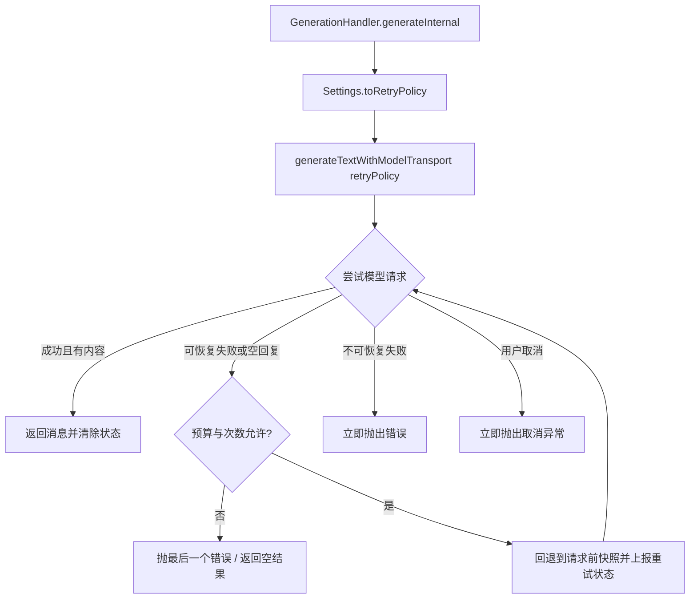

# Chat Generation Auto Retry - Plan

## Goal Capsule

- **Objective:** 聊天生成遇到可恢复的失败时，应用自动重试，用户在预算内拿到回复，而不是看到一次失败或一条空回复。
- **Means:** 在单次模型请求这一层加重试包装，用用户在设置里填写的重试间隔和最大重试时间驱动（KTD1、KTD2）。
- **Authority:** Product Contract 的需求优先于技术选择；KTD 决定实现机制；单元不得自行改写两者。
- **Execution profile:** 跨 `ai` 模块的请求层、`app` 模块的生成链路、DataStore 设置、设置界面与文案，另加 JVM 单元测试。
- **Stop conditions:** 若无法在重试前可靠丢弃上一次尝试的部分输出，或无法保证重试不重复执行工具，停止实现并回到方案层。

---

## Product Contract

### Summary

用户可以在设置里打开自动重试，并填写重试间隔和最大重试时间。聊天生成失败后，应用按间隔重新发起同一次模型请求，直到成功或超出最大重试时间；重试期间界面显示状态，用户随时可以取消。

### Problem Frame

生成失败目前只有一次机会。流式请求被中转服务中断、返回 5xx/429，或返回 200 但立刻结束（空回复）时，用户看到的是错误提示或一条没有内容的回复，只能手动重新发送。手动重发的成本落在用户身上，而且重发会重新构造整段上下文。

### Requirements

配置与生效

- R1. 设置中提供自动重试总开关；关闭时，一次请求只尝试一次，行为与现在完全一致。
- R2. 设置中提供重试间隔（秒）和最大重试时间（分钟）两个数值项，界面给出合法范围，取值超范围时按范围收窄。
- R3. 修改设置后立即生效，不需要重启应用，也不需要重新进入会话。

重试边界

- R4. 重试的作用单位是一次模型请求；工具执行不在重试范围内，重试不得重复执行已批准的工具。
- R5. 重试前必须丢弃上一次尝试产生的部分输出（含已显示的文本和已写入会话的中间状态），不得出现重复文本或半截回复。
- R6. 用户取消生成时立即停止重试，不再发起新请求。
- R7. 配置错误类失败（如无效密钥、请求格式错误）立即失败，不消耗重试预算。
- R8. 请求成功结束但没有产生任何内容（空回复）时，按可恢复失败处理，在预算内重试。

可见性与上限

- R9. 重试等待期间界面显示可见状态，重试成功或停止后状态清除。
- R10. 重试次数同时受最大重试时间与固定尝试上限约束，避免对不可用端点持续发请求。

配置持久化

- R11. 三项配置随应用备份与恢复一起保留；缺少字段的旧备份按默认值恢复，不报错。

### Scope Boundaries

- 只覆盖聊天生成。翻译、标题、建议、OCR 等调用保持现在的一次性行为。
- 不做单提供商、单模型粒度的重试配置。
- 不做指数退避、抖动、或按错误类型区分间隔。
- 不做断点续传：重试是重新发起完整请求，不是从失败处续接流。
- 不修改 OkHttp 层的超时与 `retryOnConnectionFailure` 配置。
- 不新增重试历史记录、统计页面或日志导出。

### Assumptions

- 「最大重试时间」按累计时长（预算）理解，不是最大次数。次数由预算与间隔自然约束，另有固定尝试上限 R10。
- 默认值：开启、间隔 3 秒、最大重试时间 2 分钟。
- 自动重试设置进入可移植设置，工作区归档与恢复会一并带走这些字段，不再单独排除。

### Success Criteria

- 关闭开关时，全部现有生成路径行为不变；现有测试无需修改即可通过。
- 打开开关后，网络中断、5xx/429、空回复三类失败能在预算内自动恢复并给出完整回复。
- 无效密钥一类失败不重试，错误原样上报给用户。
- 重试期间取消生成，不会在取消后继续发起请求。

---

## Planning Contract

### Key Technical Decisions

- KTD1. 重试点放在 `generateTextWithModelTransport` 的请求包装层，而不是 `ChatService` 或工具循环。理由是这里一次调用正好等于一次模型请求，流式与非流式走同一入口，并且是唯一能干净重置「本次尝试消息快照」的位置。被否方案：在 `ChatService` 重试整段生成——会把已批准的工具再跑一遍，违反 R4。
- KTD2. 策略参数由 `Settings` 经一个纯函数映射成 `RetryPolicy`，`ai` 模块只接受策略对象，不感知 Android 设置。被否方案：用 `rememberSharedPreference*` 直接读写偏好——生成层拿不到值，且绕开设置备份路径。
- KTD3. 失败分类按异常类型与 HTTP 状态判断，不按错误文本匹配。`IOException` 与超时视为可恢复；`HttpException` 带状态码时，408/409/425/429/5xx 可恢复，4xx 立即失败；状态码未知时按可恢复处理（流内错误事件常见于 200 之后的过载/限流）。被否方案：把 `HttpException` 一律当作不可重试——会让最常见的 429/5xx 失去重试；一律可重试——会让失效密钥在预算内反复请求。
- KTD4. 每次尝试使用新的流解析累积器，并在重试前通过 `onUpdateMessages` 把消息列表回退到请求前快照。被否方案：复用同一累积器并只截断文本——推理段、工具调用段与用量字段会残留，违反 R5。
- KTD5. 空回复判定为「本次尝试没有新增助手消息，或新增消息不含文本/推理/工具/图片部件」。预算耗尽时返回空结果并记日志，不抛新异常，保持现有失败面不变。
- KTD6. 三项配置加入 `Settings` 与 DataStore（session-settled: user-directed — 在偏好设置内提供用户可填写的间隔与上限：用户明确要求自行设置这两项）。
- KTD7. 设置入口放在「偏好设置 → 常规」页的新分组，不新建页面。被否方案：新建独立设置页——需要新增导航与路由项，成本高于三个控件的收益。

### High-Level Technical Design



重试序列（单次请求内部）：

```text
attempt = 1..maxAttempts
  accumulator = 新的 StreamChunkHandler
  attemptMessages = 请求前快照
  try:
    streamText().collect { chunk -> 累积; 首个内容块时清除重试状态; 上报 UI }
    无内容 -> 按可恢复失败处理
  catch CancellationException -> 直接抛出
  catch 其他:
    不可恢复 -> 抛出
    预算或次数用尽 -> 抛出最后一个错误
    否则 -> 回退快照, 上报等待状态, 延迟后进入下一次尝试
```

### Sequencing

U1 → U2 可并行推进；U3 依赖 U1；U4 依赖 KTD6，可与 U1–U3 并行；U5 依赖 U3 与 U4。

---

## Implementation Units

### U1. 重试策略与失败分类

- **Goal:** 提供纯逻辑的策略计算与失败分类，不依赖 Android 与网络。
- **Requirements:** R2, R7, R10
- **Dependencies:** 无
- **Files:** `ai/src/main/java/me/rerere/ai/provider/RetryPolicy.kt`（新建）、`ai/src/test/java/me/rerere/ai/provider/RetryPolicyTest.kt`（新建）
- **Approach:**
  - `RetryPolicy` 保存间隔毫秒、最大总时长毫秒、固定尝试上限（常量，不暴露给用户）。
  - 提供「第 N 次失败后是否继续、继续则等多久」的纯函数，输入包含已用时长与本次错误，输出延迟毫秒或停止。
  - 提供「错误是否可恢复」的分类函数，规则见 KTD3；取消异常永远不可重试。
  - 间隔与时长下限做保护，避免 0 值造成忙循环。
- **Patterns to follow:** `ai/src/test/java/me/rerere/ai/provider/ModelStreamingModeTest.kt` 的纯 JUnit + `runBlocking` 风格；`ai/src/main/java/me/rerere/ai/util/ErrorParser.kt` 的异常形状。
- **Test scenarios:**
  - 间隔内失败一次后继续，返回的延迟等于配置间隔。
  - 已用时长加下一次延迟超过最大总时长时停止。
  - 达到固定尝试上限时停止。
  - 首次失败已用时长等于上限的边界：等于上限仍继续一次（判定用「已用时长 + 下一次延迟超过上限才停止」），超过上限则停止。实施后已按实际语义修正本条。
  - 间隔为 0 或负数时按最小正间隔处理，不出现零延迟循环。
  - `IOException` 与超时异常判定为可恢复。
  - `HttpException` 状态 401/403/400 判定为不可恢复。
  - `HttpException` 状态 429/500/503 判定为可恢复。
  - `HttpException` 状态未知时判定为可恢复，与 KTD3 一致。
  - 取消异常判定为不可恢复。
- **Verification:** 策略与分类的全部单元测试通过，且测试不依赖真实网络与真实等待。

### U2. HTTP 状态贯通到错误对象

- **Goal:** 让失败分类能拿到 HTTP 状态码，使配置错误快速失败、限流与 5xx 可重试。
- **Requirements:** R7
- **Dependencies:** 无
- **Files:** `ai/src/main/java/me/rerere/ai/util/ErrorParser.kt`、`ai/src/main/java/me/rerere/ai/provider/providers/openai/ChatCompletionsAPI.kt`、`ai/src/main/java/me/rerere/ai/provider/providers/openai/ResponseAPI.kt`、`ai/src/main/java/me/rerere/ai/provider/providers/claude/ClaudeProvider.kt`、`ai/src/main/java/me/rerere/ai/provider/providers/google/GoogleProvider.kt`、`ai/src/test/java/me/rerere/ai/util/ErrorParserStatusTest.kt`（新建）
- **Approach:**
  - 给 `HttpException` 增加可空状态字段，默认空；解析函数接收状态并沿递归传递。
  - 三处流式失败处理（OpenAI Chat Completions、OpenAI Response API、Claude）在构造错误时带上 `response?.code`。
  - Google 失败路径按同样规则补上状态，保持四处一致。
  - 流内错误事件（200 之后）保持状态为空，由分类函数按可恢复处理。
- **Execution note:** `ai/src/main/java/me/rerere/ai/provider/providers/claude/ClaudeProvider.kt` 当前带其他会话的未提交改动；开工前重新读取该文件，只做最小合并，不得回退或覆盖既有改动。
- **Test scenarios:**
  - 带状态的解析结果保留状态码，嵌套错误字段递归后状态不丢失。
  - 未传状态时状态为空，且不抛异常。
  - 非 JSON 或空响应体不使错误构造失败。
- **Verification:** `ai` 模块编译通过；新增测试通过；四处失败路径都带状态可用代码检索确认。

### U3. 请求级重试包装

- **Goal:** 在单次模型请求层实现重试循环、快照回退、状态回调与取消传播。
- **Requirements:** R4, R5, R6, R8, R9
- **Dependencies:** U1
- **Files:** `ai/src/main/java/me/rerere/ai/provider/Provider.kt`、`ai/src/test/java/me/rerere/ai/provider/GenerationRetryTest.kt`（新建）
- **Approach:**
  - 包装函数新增可空策略参数与可空状态回调参数；两者都为空时行为与现在逐字节一致。
  - 流式路径按 KTD4 每次尝试新建累积器并回退快照，回退状态也要通过更新回调发出，保证界面与会话不残留半截内容。
  - 空回复按 KTD5 判定为可恢复失败；预算耗尽时返回空结果。
  - 状态回调只在本次请求确实进入过等待时才发出恢复事件（见 R9 与 U5 的清除规则）。
  - 非流式路径同样受策略控制，重试一次完整调用即可。
- **Patterns to follow:** `Provider.kt` 现有的 `generateTextWithModelTransport` 结构；`ai/src/test/java/me/rerere/ai/provider/ModelStreamingModeTest.kt` 的假 Provider 写法。
- **Test scenarios:**
  - 流式请求连续失败两次后成功：第三返回内容正确，请求次数为三。
  - 部分输出后失败再重试：中间更新先出现半截文本，随后出现回退到快照的更新，最终文本不重复。
  - 非流式请求失败后重试成功，调用次数为二。
  - 取消异常直接抛出，不再发起后续请求（调用次数为一）。
  - 不可恢复错误直接抛出，调用次数为一。
  - 预算或次数耗尽时抛出最后一次错误，请求次数等于上限。
  - 首次请求直接返回空回复且允许重试时，发起第二次请求并返回第二次内容。
  - 空回复且不允许重试时返回空结果，不抛异常。
  - 不传策略时不发生任何重试，且不触发状态回调。
  - 重试成功后状态回调出现等待事件与恢复事件，顺序正确。
- **Verification:** 全部测试通过；测试使用毫秒级间隔，不产生真实秒级等待。

### U4. 设置项持久化与设置界面

- **Goal:** 用户能填写三项配置，值能保存、能读回、能在界面约束范围。
- **Requirements:** R1, R2, R3, R11
- **Dependencies:** 无
- **Files:** `app/src/main/java/me/rerere/rikkahub/data/datastore/PreferencesStore.kt`、`app/src/main/java/me/rerere/rikkahub/ui/pages/setting/SettingVM.kt`、`app/src/main/java/me/rerere/rikkahub/ui/pages/setting/SettingPreferencesGeneralPage.kt`、`app/src/main/java/me/rerere/rikkahub/data/ai/AutoRetrySettings.kt`（新建）、`app/src/main/res/values/strings.xml`、`app/src/main/res/values-zh/strings.xml`、`app/src/test/java/me/rerere/rikkahub/data/datastore/AutoRetrySettingsTest.kt`（新建）
- **Approach:**
  - `Settings` 增加开关、间隔秒、最大重试分钟三个字段并给默认值；DataStore 增加对应键，写入、读取映射与 `writeSettings` 同步补齐。
  - `SettingVM.updateSettings` 的逐字段复制必须补上这三个字段，否则界面改动会静默丢失。这是本单元最容易漏的一处。
  - 新建纯函数把 `Settings` 映射为 `RetryPolicy`：关闭时返回空，开启时按范围收窄间隔与时长。
  - 界面在「偏好设置 → 常规」页新增一个分组：开关，开关旁的间隔与最大重试时间输入（或滑条），并在说明文字里写清单位与范围。
  - 文案同时补齐英文与简体中文资源。
- **Patterns to follow:** `SettingPreferencesGeneralPage.kt` 现有分组与 `Slider` 用法；`SettingPreferencesUIPage.kt` 的 `updateDisplaySetting` 写法；`PreferencesStore.kt` 中其他 `Int` 偏好项的键命名。
- **Test scenarios:**
  - 旧设置 JSON 缺少三个字段时解码成功并得到默认值。
  - 三个字段序列化后往返一致。
  - 关闭开关时映射结果为空策略。
  - 间隔与时长超范围时映射结果被收窄到边界值。
  - 间隔为 0 时映射结果使用最小正间隔，不是 0。
- **Verification:** `app` 模块单测通过；设置页三个控件可交互，改动后重新进入页面仍保留；关闭开关后生成链路不进入重试分支。

### U5. 生成链路接入与重试状态文案

- **Goal:** 聊天生成使用策略，重试期间显示状态，结束后清除状态。
- **Requirements:** R3, R9
- **Dependencies:** U3, U4
- **Files:** `app/src/main/java/me/rerere/rikkahub/data/ai/GenerationHandler.kt`、`app/src/main/res/values/strings.xml`、`app/src/main/res/values-zh/strings.xml`
- **Approach:**
  - `generateInternal` 把 `settings` 映射出的策略传入包装函数；翻译与标题等调用不传策略，保持现状。
  - 状态回调映射为界面文案（含第几次尝试与等待秒数），写入现有的 `processingStatus`；恢复事件把状态清空。
  - 只在本次请求确实等待过时才写状态，避免覆盖其他流程设置的状态文本。
  - 状态文案随语言资源提供，中英各一份。
- **Patterns to follow:** `GenerationHandler.generateInternal` 现有的 `processingStatus` 传递；`data/ai/transformers/OcrTransformer.kt` 里设置与清除 `processingStatus` 的写法。
- **Test expectation: none -- Android Context、仓储与网络都在这一层，单元测试价值低于设备验收；本单元由 U3 的包装层测试与设备验收共同覆盖。**
- **Verification:** `app` 模块编译通过；设备上制造一次可恢复失败，界面出现重试状态文案，成功后文案消失；关闭开关后不再出现该文案。

---

## Verification Contract

| 检查 | 命令或方式 | 适用单元 |
| --- | --- | --- |
| 环境前置 | `C:/Users/WJZN/heimao-AI/tools/check-environment.ps1`，JDK 21 不可用则停止 | 全部 |
| `ai` 模块单测 | `./gradlew :ai:testDebugUnitTest` | U1, U2, U3 |
| 应用 JVM 单测 | `./gradlew :app:testDebugUnitTest -x :app:processDebugGoogleServices` | U4, U5 |
| AndroidTest 源码编译 | `./gradlew :app:compileDebugAndroidTestKotlin -x :app:processDebugGoogleServices` | U5 |
| 差异卫生 | `git diff --check`，并比较任务前后的 `git status --porcelain=v2` | 全部 |
| 设备验收 | 真机：断网或改错 baseUrl 触发失败，确认状态文案、自动恢复、取消立即停止、空回复重试、无效密钥不重试 | U3, U4, U5 |

工作目录固定为 `C:/Users/WJZN/heimao-AI/project`。没有连接设备时必须明确报告设备验收未执行，不得以编译通过代替。

---

## Definition of Done

- U1–U5 全部完成，且每个单元的测试场景在测试文件中都有对应用例。
- `:ai:testDebugUnitTest` 与 `:app:testDebugUnitTest` 通过；AndroidTest 源码编译通过。
- 关闭开关时的行为与改动前一致：不新增请求、不写状态文案、不改变错误上报。
- 设置三项能保存、读回、跨进程重启保留，并在界面按范围收窄。
- 重试期间取消生成不产生额外请求；重试成功后会话里没有重复文本或半截回复。
- 未执行项（设备验收、APK 构建、上游同步）在交付报告中逐条说明真实原因。
- 清理标准：本次未采用的实验代码、临时日志与调试分支必须删除，不留在差异里。
- `C:/Users/WJZN/Rikkhub-Windows` 未被触碰；未提交其他会话已有的改动。

---

## 实施记录（2026-09-10）

状态：U1–U5 已实现，JVM 侧验证通过；设备验收未执行（未连接真机）。

| 单元 | 状态 | 落地文件 |
| --- | --- | --- |
| U1 | 已完成 | `ai/src/main/java/me/rerere/ai/provider/RetryPolicy.kt`、`ai/src/test/java/me/rerere/ai/provider/RetryPolicyTest.kt` |
| U2 | 已完成 | `ai/src/main/java/me/rerere/ai/util/ErrorParser.kt`、`providers/openai/ChatCompletionsAPI.kt`、`providers/openai/ResponseAPI.kt`、`providers/claude/ClaudeProvider.kt`、`providers/google/GoogleProvider.kt`、`ErrorParserStatusTest.kt` |
| U3 | 已完成 | `ai/src/main/java/me/rerere/ai/provider/Provider.kt`（`withRetries` + `RetryStatus`）、`GenerationRetryTest.kt` |
| U4 | 已完成 | `app/.../data/datastore/PreferencesStore.kt`、`app/.../ui/pages/setting/SettingVM.kt`、`app/.../data/ai/AutoRetrySettings.kt`、`app/.../ui/pages/setting/SettingPreferencesGeneralPage.kt`、`values/strings.xml`、`values-zh/strings.xml`、`AutoRetrySettingsTest.kt` |
| U5 | 已完成 | `app/.../data/ai/GenerationHandler.kt`（传策略 + 状态文案）、`chat_generation_retrying` 双语文案 |

### 与方案的偏差（都已核实）

1. 边界语义：判定用「已用时长 + 下一次延迟 <= 最大总时长」，等于上限仍会再试一次。U1 测试场景条目已按实际语义改写。
2. 状态文案 key 落地为 `chat_generation_retrying`，放在 `chat_*` 分组，与方案里的占位命名不同。
3. 设置界面滑条用「拖动改本地状态、松手写设置」，避免拖动过程中每个经过值都写 DataStore；取值范围常量与映射函数共用同一组边界。
4. `ai` 模块的重试日志用 `println`，不用 `android.util.Log`：该模块单测没有 Android 运行时。

### 验证证据

| 命令 | 结果 |
| --- | --- |
| `./gradlew :ai:testDebugUnitTest` | 通过，214 用例 0 失败（本次新增 11 + 6 + 11 = 28 例） |
| `./gradlew :app:testDebugUnitTest -x :app:processDebugGoogleServices` | 通过，338 用例 0 失败（本次新增 5 例） |
| `./gradlew :app:compileDebugAndroidTestKotlin -x :app:processDebugGoogleServices` | 通过 |
| `git diff --check` | 无空白错误 |

### 未覆盖项

- 真机验收：断网或错 baseUrl 下的状态文案、重试成功后的会话内容、取消立即停止、无效密钥快速失败，均未实机验证。
- APK 构建、发布、上游同步不在本次范围。
