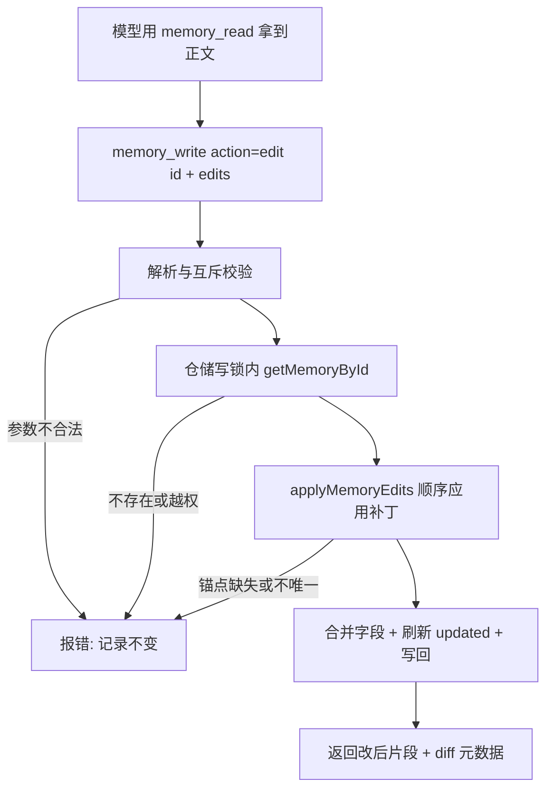

# Layered Memory Local Edit - Plan

## Goal Capsule

- **Objective:** 助手修改一条记忆时只表达"哪个点改成什么"，而不是把整段正文重写一遍后覆盖；一条记录上的多个修改点要么在一次调用里原子完成，要么分布在互不依赖的并行调用里。
- **Means:** 给 `memory_write` 增加锚点式补丁入口（`edits`），复用现成的 `replaceText` 替换引擎但收窄匹配策略，并把读-改-写放进仓储层的写锁（KTD1–KTD5）。
- **Authority:** Product Contract 的需求优先于技术选择；KTD 决定实现机制；单元不得自行改写两者。
- **Execution profile:** 分层记忆写入链路：工具 schema 与校验、`MemoryRepository` 写路径、分层记忆提示词、记忆工具 UI 渲染、JVM 单测。
- **Stop conditions:** 若无法保证"补丁只落在唯一命中处，失败时记录逐字节不变"，停止实现并回到方案层；若必须新增数据库列或改变 `memory_read` 的输出格式才能完成，也先回到方案层确认。

---

## Product Contract

### Summary

`memory_write` 的修改动作从"整段正文覆盖"改为"锚点式局部修改"：模型给出记录 id 与一个或多个 `{old_text, new_text}`，服务端在执行时刻读出记录、按顺序应用补丁、写回。整段重写保留为显式动作 `replace`。

### Problem Frame

现在 `memory_write` 的 `edit` 必须携带完整 `content`，写库时整段替换（`MemoryRepository.writeLayeredMemory`，且 `LayeredMemoryTools` 的 schema 把 `content` 列为必填）。于是"把 12000 改成 12500"这种修改，模型要重抄整条记录：

- 输出 token 与记录长度成正比；
- 抄写过程中容易顺手改动无关行（格式、措辞、丢行），用户看不出这是副作用；
- 记录越长，越可能被输出上限截断。

期望的行为是"改一个点就说一个点"。上层工具执行是串行的（`GenerationHandler` 的 `toolsToProcess.forEach`），所以"多次调用"实际是"同一条消息里按顺序执行，且这一轮看不到彼此的结果"，设计必须写明这一点，否则模型会拼出互相依赖的调用。

### Requirements

写入方式

- R1. `memory_write` 的修改动作默认是局部修改：给出记录 id 与一个或多个 `{old_text, new_text}` 补丁，不要求提供整段正文。
- R2. 局部修改只改动命中处，记录中其余内容逐字节不变。
- R3. 每个补丁的锚点必须唯一命中：找不到或命中多处时拒绝本次写入，并给出可据以修正的原因（含记录 id 与"重新读取后再改"的提示），记录内容不变。
- R4. 一次调用可携带多个补丁，在一条记录内按给定顺序应用，且原子生效：任一处失败则整次调用不写入。
- R5. 同一个模型回合里的多个 `memory_write` 调用按顺序执行；不同记录上的修改可以并行调用；工具描述必须写明"同一轮里看不到兄弟调用的结果"，有依赖关系的修改（如先 create 再 edit）必须分轮。
- R6. 整段重写保留为显式动作 `action=replace`，要求 id 与完整 `content`，并且不允许与局部补丁同时出现。
- R7. `edit` 至少要有一个改动点（补丁或字段），否则拒绝，避免"空写"把记录的更新时间刷新掉。

字段与边界

- R8. 字段级修改（category/title/confidence_flags/tags/product）保持现有"不给就不动、给了就设置"的语义，并可与补丁在同一次调用里一起提交。
- R9. `create` 的必填与枚举校验保持现状，且不允许携带补丁。
- R10. 只能修改属于当前记忆范围的记录；记录不存在或不属于该范围时拒绝（保持现有校验）。
- R11. 修改成功后返回：记录 id、本次模式、替换处数、更新日期，以及改动处的文本片段；片段有长度上限，超出即截断。
- R12. 正文改动在聊天界面以 diff 呈现，可审计程度与文件编辑一致。
- R13. 记忆提示词与工具描述使用同一套说法：默认局部修改；同一条记录多点优先一次调用多补丁；不同记录才并行；有依赖分轮。

### Scope Boundaries

- 不改 `memory_read` 的输出格式，不引入行号寻址。
- 不改 `useLayeredMemory = false` 时的旧 `memory_tool`。
- 不做正则替换、不做 `replace_all`、不做按行号替换。
- 不加版本号/内容指纹列，不改数据库版本（理由见 KTD6）。
- 不做记忆修改历史表、撤销栈、审计页。
- 不改助手记忆页（`AssistantMemoryPage`）的用户编辑方式。
- 不改 `memory_consolidate` 的动作集合，只更新它的说明文字以指向新的落地方式。

### Assumptions

- 记忆正文的自然单位是行或小段，锚点在模型刚读取的正文里能逐字复制（引擎自带逐行 trim 容错）。
- 旧记录（只有 content、没有 category/title 的 Legacy 记录）同样支持局部修改。
- 全局记忆（`GLOBAL_MEMORY_ID`）与助手记忆走同一条写路径，本次改动对两者一致生效。

### Success Criteria

- 单点修改的调用入参里不含整段正文（结构性判据：`edit` 模式禁止 `content`）。
- 局部修改后，除命中处外记录内容逐字节相同（测试断言原文与结果只有一处差异）。
- 锚点缺失或不唯一时记录内容不变，且错误信息包含记录 id 与失败原因。
- 同一记录的多个点在一次调用里按顺序原子应用；跨记录并行调用都能落地。
- 整段重写仍可用，但必须显式 `action=replace`；`content` 与 `edits` 同时出现一律报错。
- 一次"没有改动点"的 `edit` 被拒绝，记录更新时间不被刷新。

---

## Planning Contract

### Key Technical Decisions

- KTD1. 坐标用锚点文本（`old_text`），不用行号，也不用 key。被否：行号——`memory_read` 不返回行号，任何一次改动都会让后文行号漂移；key 寻址——`extractKeyValues` 的正则只认 ASCII 字母开头的 key，值不能含 `, ; |` 与换行、上限 60 字符，中文参数与含标点的值根本提取不到 key，把写入口建在它上面会让"改不到"成为常态，而且它只是检测端的约定，不该升级成写入语法。
- KTD2. 复用 `replaceText` 引擎，但记忆使用更窄的替换器名单：`ExactReplacer` + `LineTrimmedReplacer`，去掉 `BlockAnchorReplacer`，并且永远 `replaceAll = false`。被否：沿用三级降级——首尾锚点匹配会容忍中间行差异，一旦贴到错误区块，错误内容会进入之后所有对话的提示词。
- KTD3. 一次调用可带 1..N 个补丁，一条记录内按顺序应用且原子生效；跨记录才用并行调用。被否：严格"一次调用一个点"——同一记录多点拆成多次调用时，中途失败会留下改了一半的记录，而模型在同一轮里看不到前一次调用的结果，无法可靠补正。
- KTD4. 局部修改与整段重写互斥且语义显式：`edit` = 局部，`replace` = 整段；`content` 出现在 `edit` 里直接报错并提示改用 `replace`。被否：`content` 优先——静默整段覆盖正是本次要消灭的行为。
- KTD5. 读-改-写在执行时刻于 `MemoryRepository` 内完成，并用仓储级 `Mutex` 串行化写操作。被否：按记录分锁——当前是单进程、Koin `single` 单实例，分锁只是多一层状态；依赖"工具串行执行"——未来一旦并行执行工具就会丢更新。
- KTD6. 不新增数据库列、不升数据库版本。被否：`expected_version` / 内容指纹列——现有 `updated` 是天粒度（`LocalDate`），同日修改查不出来，加列只能给出假安全感；锚点唯一性 + 执行时刻读取已覆盖主要冲突面。
- KTD7. 返回值是"改后片段 + 计数 + 更新日期"，不是整条记录，也不是一句 success；正文改动同时把 unified diff 放进输出部件元数据供 UI 展示。被否：返回整条记录——回到大输出；只返回 success——模型无法自查，只能再读一次。

### High-Level Technical Design



补丁应用（纯函数）：

```text
applyMemoryEdits(content, edits):
  for each (old_text, new_text) in edits:
    require old_text 非空
    用 [Exact, LineTrimmed] 逐级尝试, replaceAll = false
    无命中 -> 抛错(锚点不存在)
    命中 > 1 -> 抛错(锚点不唯一, 提示补上下文)
    content = 替换后的文本
  return content
```

### Sequencing

U1 → U2 依赖 U1 的纯函数；U3 依赖 U2 的写路径；U4 依赖 U3 的输出形状；U5 可与 U1 并行（只改文案），但必须在 U3 之后复查一次措辞一致性。

---

## Implementation Units

### U1. 补丁纯函数

- **Goal:** 提供只依赖文本的补丁应用函数，含锚点唯一性规则与可据以修正的错误信息。
- **Requirements:** R2, R3, R4
- **Dependencies:** 无
- **Files:** `app/src/main/java/me/rerere/rikkahub/data/repository/MemoryPatch.kt`（新建）、`app/src/test/java/me/rerere/rikkahub/data/repository/MemoryPatchTest.kt`（新建）
- **Approach:**
  - `data class MemoryEdit(val oldText: String, val newText: String)`；`internal val MemoryEditReplacers = listOf(ExactReplacer, LineTrimmedReplacer)`。
  - `internal fun applyMemoryEdits(content: String, edits: List<MemoryEdit>): String`：按顺序应用，任一处失败抛 `IllegalArgumentException`，消息区分"锚点不存在"与"命中 N 处"，并带上"用 memory_read 重新读取后逐字复制 old_text"的提示。
  - 空补丁列表、空 `old_text` 一律拒绝；`new_text` 允许为空（等于删掉命中处）。
- **Patterns to follow:** `app/src/main/java/me/rerere/rikkahub/data/ai/tools/TextReplacers.kt` 的 `replaceText` 签名与错误措辞；`app/src/test/java/me/rerere/rikkahub/data/ai/tools/TextReplacersTest.kt` 的测试风格。
- **Test scenarios:**
  - 单点替换命中唯一处：只改动该处，其余内容逐字节相同。
  - 锚点不存在：抛错，消息含"重新读取"提示。
  - 锚点命中两处：抛错，不返回"猜一处"的结果。
  - 多补丁顺序应用：后一个补丁作用于前一个的结果；两个补丁各改一处，最终两处都改到。
  - 后一个补丁的锚点被前一个补丁删除：抛错，且调用方拿不到半成品结果。
  - `new_text` 为空：命中处被删除，其余内容不变。
  - 命中处存在缩进 / 行尾空白 / CRLF 差异：逐行 trim 命中并替换。
  - 两行以上、仅首尾相同的区块：`BlockAnchorReplacer` 不参与，因此不会被模糊命中（负例断言）。
  - `old_text` 为空或 `edits` 为空列表：抛错。
- **Verification:** 新增用例全部通过；测试为纯 JVM，不依赖 Android 与数据库。

### U2. 仓储写路径：局部修改 + 写锁

- **Goal:** 让仓储支持"只改正文中的某几处"，并保证并发调用不丢更新。
- **Requirements:** R2, R4, R7, R8, R10
- **Dependencies:** U1
- **Files:** `app/src/main/java/me/rerere/rikkahub/data/repository/MemoryRepository.kt`、`app/src/test/java/me/rerere/rikkahub/data/repository/LayeredMemoryRepositoryTest.kt`
- **Approach:**
  - `writeLayeredMemory` 的 `content` 参数改为可空，新增 `edits: List<MemoryEdit> = emptyList()`：`id == null`（create）仍要求 `content` 且禁止 `edits`；`id != null` 时 `content` 与 `edits` 二选一（同时给即报错），也允许只改字段不动正文。
  - `id != null` 且 `edits` 非空时，在写锁内读出当前记录、调用 `applyMemoryEdits`、再写回；补丁失败时数据库不变。
  - 加"至少一个改动点"校验：`edits` 为空且字段参数全为 null 时拒绝，避免空写刷新 `updated`。
  - 新增仓储级 `private val writeMutex = Mutex()`，把 create/edit/replace 的读-改-写与 `archiveMemories` 一起串行化（Koin 注册为 `single`，单实例有效）。
  - 保留现有归属校验：记录不存在或不属于该 `assistantId` 时报错且不写库。
  - 调用方只有 `LayeredMemoryTools` 与该文件的测试，签名变更需同时更新这两处。
- **Patterns to follow:** 该文件现有 `writeLayeredMemory` 的 `require` / `error` 措辞与合并语义；`LayeredMemoryRepositoryTest` 的 `FakeMemoryDAO`。
- **Test scenarios:**
  - 补丁修改一条记录：读回后除命中处外内容与原文逐字节相同，`updated` 刷新为今天。
  - 两次补丁分别改不同锚点：两次改动都在结果里（防丢失更新）。
  - 后一次补丁的锚点已被前一次删除：抛错，数据库内容保持前一次的结果。
  - 字段级修改 + 补丁在同一次调用：两者都生效。
  - 只有字段改动、没有补丁：正文不动，正常写入（对应 R8）。
  - 既无补丁又无字段改动：拒绝，且 `updated` 未被刷新。
  - `content` 与 `edits` 同时提供：拒绝。
  - create 携带 `edits`：拒绝。
  - 记录不存在或属于另一个助手：拒绝且数据库无变化。
  - 并发两次针对同一记录的补丁（`runBlocking` + `async`）：两次改动都保留，不互相覆盖。
- **Verification:** `:app:testDebugUnitTest` 通过；新增用例覆盖上面全部场景。

### U3. 工具层：schema、互斥校验与返回体

- **Goal:** `memory_write` 对外表现新语义：默认局部修改、可多补丁、整段重写显式化。
- **Requirements:** R1, R3, R5, R6, R9, R11
- **Dependencies:** U2
- **Files:** `app/src/main/java/me/rerere/rikkahub/data/ai/tools/LayeredMemoryTools.kt`、`app/src/test/java/me/rerere/rikkahub/data/ai/tools/LayeredMemoryToolsValidationTest.kt`
- **Approach:**
  - 参数解析从 `execute` 里抽成纯函数（例如 `parseMemoryWriteRequest(params): MemoryWriteCommand`，返回 create/edit/replace 三种命令对象），`execute` 只负责调用仓储与组装返回体，便于 JVM 测试。
  - schema：`action` 枚举加 `replace`；新增 `edits`（数组，元素 `{old_text, new_text}`，上限 20 个）；`content` 不再全局必填，`required` 收敛为 `["action"]`，由解析函数给出精确的必填错误。
  - 互斥规则：`edit` 带 `content` → 报错并提示改用 `action=replace`；`replace` 必须带 `content` 且不得带 `edits`；`create` 不得带 `edits`；`edit` 与 `replace` 都必须带 `id`。
  - 返回体：`{success, id, mode, replacements, updated, fragment}`；`fragment` 取改动处前后各 2 行、总长上限 1200 字符，超出截断并标注。
  - 描述文字重写：默认局部修改、锚点逐字复制且唯一、同一记录多点用一次调用的 `edits`、不同记录可并行、同一轮看不到兄弟调用结果所以有依赖必须分轮；保留敏感信息与"不要直接展示记忆内容"的既有约束。
- **Patterns to follow:** 该文件现有 `validateWriteRequest` 的纯函数 + 错误消息风格；`workspace_edit_file` 的 `old_text` / `new_text` 描述措辞。
- **Test scenarios:**
  - `edit` + `id` + 一个补丁：解析通过，命令里不含 content。
  - `edit` + `id` + 三个补丁：三个补丁按给定顺序保留。
  - `edit` 带 `content`：报错，消息指向 `replace`。
  - `edit` 既无补丁又无字段：报错。
  - `replace` 缺 `content`：报错；`replace` 带 `edits`：报错。
  - `create` 带 `edits`：报错；`create` 缺 category/title/confidence_flags：沿用现有错误。
  - `edits` 元素缺 `old_text` 或为空串：报错。
  - `edits` 超过 20 个：报错。
  - `edits` 中出现空 `new_text`：允许（删除该处）。
  - 未知 action：报错并列出允许值。
- **Verification:** 新增与改写的解析用例全部通过；描述里的并行规则与 U5 的提示词措辞一致。

### U4. 记忆修改的可见性（diff）

- **Goal:** 让"助手改了哪条记忆、改了哪几处"在聊天界面里和改文件一样看得见。
- **Requirements:** R12
- **Dependencies:** U3
- **Files:** `app/src/main/java/me/rerere/rikkahub/data/ai/tools/LayeredMemoryTools.kt`（输出部件带元数据）、`app/src/main/java/me/rerere/rikkahub/ui/components/message/tools/BuiltinToolUIs.kt`（新增 `memory_write` 渲染器并注册）、`app/src/main/res/values/strings.xml`、`app/src/main/res/values-zh/strings.xml`
- **Approach:**
  - 正文改动时用 `generateUnifiedDiff(original, updated, "memory/#id")` 生成 diff，挂到输出部件的 `DiffMetadata` 上（`edit` 与 `replace` 一致处理；纯字段改动不生成 diff）。
  - 渲染器按 `action` 区分标题（新建记忆 / 修改记忆 / 重写记忆），摘要显示 `+N/-N` 与 diff 片段，详情显示完整 diff；复用 `DiffView`、`parseDiffStats` 与 `WorkspaceToolUIs` 的既有用法。
  - 新增中英文案；`memory_read` 与 `memory_consolidate` 保持默认渲染。
- **Patterns to follow:** `WorkspaceToolUIs.kt` 中 `workspace_edit_file` 的渲染（`diffOf` + `Summary` + `Preview`）；`BuiltinToolUIs.kt` 中 `MemoryToolUI` 的注册方式与 `ToolUIRegistry`。
- **Test expectation:** none -- 纯 Compose 渲染层，单元测试价值低于设备验收；由设备验收确认 diff 正确展示。
- **Verification:** `:app` 编译通过；设备上让助手改一条记忆，聊天里出现 diff 卡片且 `+/-` 行数与实际改动一致。

### U5. 提示词与说明同步

- **Goal:** 模型在固定工具描述里读到一致的按需读取与局部修改规则，不会退回"整段重写"；不自动注入目录或 ACTIVE 正文。
- **Requirements:** R5, R13
- **Dependencies:** 无（但需在 U3 之后复查一致性）
- **Files:** `app/src/main/java/me/rerere/rikkahub/data/ai/tools/LayeredMemoryTools.kt`（固定读取、写入与维护说明）
- **Approach:**
  - 分层模式只注册 `memory_read`、`memory_write`、`memory_consolidate`，不自动读取目录或正文，不参与普通记忆快照、增量和专用缓存通道。读取结果作为工具输出保留在对话中。
  - 工具固定规则：默认用局部修改维护已有记录；同一条记录多点优先一次调用多补丁；不同记录可并行；先 create 拿到 id 才能 edit，必须分轮。
  - `memory_consolidate` 的 `suggest_upgrades` 说明补一句落地方式：用 `memory_write action=edit` 只改 `confidence_flags`，不必重写正文。
  - 七天的过期确认规则与敏感信息规则保持不变。
- **Patterns to follow:** 该文件现有中英混排的条目写法（英文一句、中文一句）。
- **Test scenarios:**
  - 检查关闭／普通／分层模式隔离、空库与非空库不改变固定工具定义、分层模式无自动注入、历史与本轮工具结果保持原样，以及当前有效模型的工具能力门禁。
  - 模式或全局范围切换只影响后续操作，不删除历史结果；工具固定说明保留七天待确认规则与局部修改约束。
- **Verification:** `:app:testDebugUnitTest` 通过；提示词测试与工具描述用词一致。

---

## Verification Contract

| 检查 | 命令或方式 | 适用单元 |
| --- | --- | --- |
| 环境前置 | `C:/Users/WJZN/heimao-AI/tools/check-environment.ps1`，JDK 21 不可用则停止 | 全部 |
| 应用 JVM 单测 | `./gradlew :app:testDebugUnitTest -x :app:processDebugGoogleServices` | U1, U2, U3, U5 |
| AndroidTest 源码编译 | `./gradlew :app:compileDebugAndroidTestKotlin -x :app:processDebugGoogleServices` | 全部（仅当触及 AndroidTest） |
| 差异卫生 | `git diff --check`，并比较任务前后的 `git status --porcelain=v2` | 全部 |
| 设备验收 | 真机：让助手改一条真实记忆（单点 / 多点 / 跨记录并行），再制造锚点缺失与锚点重复各一次，确认拒绝且记录不变、diff 卡片正确 | U3, U4 |

工作目录固定为 `C:/Users/WJZN/heimao-AI/project`。没有连接设备时必须明确报告设备验收未执行，不得以编译通过代替。

---

## Definition of Done

- U1–U5 完成，每个单元的测试场景在测试文件里都有对应用例。
- `:app:testDebugUnitTest` 通过；触及 AndroidTest 时其源码编译通过。
- `edit` 模式的入参不含 `content`；`content` 与 `edits` 同时出现必定报错。
- 锚点缺失/重复时数据库内容不变，错误信息包含记录 id 与原因。
- 同一记录多点补丁原子生效；跨记录并行调用都落地；并发两次写同一记录不丢更新。
- 空改动点被拒绝，且不刷新 `updated`。
- 未执行项（设备验收、APK 构建、上游同步）在交付报告中逐条说明真实原因。
- 清理标准：本次未采用的实验代码、临时日志与调试分支必须删除，不留在差异里。
- `C:/Users/WJZN/Rikkhub-Windows` 未被触碰；未提交其他会话已有的改动。

---

## 实施记录（2026-09-10）

状态：U1–U5 已实现，JVM 侧验证通过；设备验收未执行（无真机连接，且 NDK 不完整无法出 APK）。

| 单元 | 状态 | 落地文件 |
| --- | --- | --- |
| U1 | 已完成 | `data/repository/MemoryPatch.kt`（`MemoryEdit`、`MemoryEditReplacers`、`applyMemoryEdits`）、`app/src/test/.../repository/MemoryPatchTest.kt` |
| U2 | 已完成 | `data/repository/MemoryRepository.kt`（`content: String?` + `edits`、`writeMutex`、`LayeredMemoryWriteResult`、补丁错误带记录 id）、`LayeredMemoryRepositoryTest.kt` |
| U3 | 已完成 | `data/ai/tools/LayeredMemoryTools.kt`（`parseMemoryWriteRequest` + `MemoryWriteCommand`、schema 加 `edits`/`replace`、返回体带 `fragment` 与 `DiffMetadata`）、`LayeredMemoryToolsValidationTest.kt` |
| U4 | 已完成（渲染未自动化测试） | `ui/components/message/tools/BuiltinToolUIs.kt`（`MemoryWriteToolUI`）、`ToolUI.kt`（注册）、`values/strings.xml`、`values-zh/strings.xml` |
| U5 | 已完成 | `data/ai/tools/LayeredMemoryTools.kt`（分层固定工具说明承载按需读取与局部修改规则）、`LayeredMemoryTools.kt`（`suggest_upgrades` 补落地方式）、`app/src/test/.../ai/LayeredMemoryPromptTest.kt` |

### 与方案的偏差（已核实）

1. 新增 `LayeredMemoryWriteResult(memory, previousContent)` 作为 `writeLayeredMemory` 的返回值。方案里没写：工具层要生成 diff 必须知道写入前的正文，用返回值携带比“写之前再读一次”更准，也避开写后读的竞态。影响面：调用方只有 `LayeredMemoryTools` 与测试，已同步更新。
2. U1 没有直接复用共享的 `replaceText`。方案写的是复用该引擎，实际做法是在 `MemoryPatch.kt` 内用**同一组替换器**（`ExactReplacer` + `LineTrimmedReplacer`）自建按级尝试。原因：`replaceText` 的多处命中错误文案里带“or set replace_all=true”，而记忆补丁故意没有这个参数，直接用会让模型尝试一个不存在的开关；只为改文案去给共享引擎加参数不划算。
3. 新增 `app/src/test/.../tools/LayeredMemoryWriteToolTest.kt`（9 例）。方案把 U4 标为“无单测”，但这 9 例覆盖的是 U3 的接线（工具 schema 入参 → 解析 → 仓储写库 → 返回体与 `DiffMetadata`），原本不在任何测试里；其中包含“回执是摘要、不含整段 content”“create 无 diff 元数据”这类合同断言。
4. U4 的 Compose 渲染本身仍无自动化测试，只有“编译通过 + 数据层正确”。
5. 补丁失败的错误信息在仓储层包了记录 id（`memory record #12: edits[0].old_text was not found ...`），用于满足 R3 里“错误信息包含记录 id”的要求；纯函数 `applyMemoryEdits` 本身不带 id（它不知道 id）。
6. `memory_write` 的描述比改动前长（新增并行调用边界、锚点唯一性、`content` 与 `edits` 互斥）。它属于注入 system prompt 的稳定前缀，变长是方案“行为改变主要来自 schema 与描述”的必然代价。

### 验证证据

| 命令 | 结果 |
| --- | --- |
| `C:/Users/WJZN/heimao-AI/tools/check-environment.ps1` | JDK 21 通过、SDK 存在、Gradle Wrapper 存在；NDK `28.2.13676358` 不完整（只影响 APK 构建） |
| `./gradlew :app:testDebugUnitTest -x :app:processDebugGoogleServices` | 通过：54 个测试类、385 用例、0 失败 0 错误（记忆相关 109 例） |
| `./gradlew :app:compileDebugAndroidTestKotlin -x :app:processDebugGoogleServices` | 通过 |
| `git diff --check` | 干净（仅 CRLF 提示） |
| `git status --porcelain=v2` | 任务前 32 条 → 任务后 43 条，新增条目全部是本任务的 7 个修改 + 4 个新文件 |
| `./gradlew :app:assembleRelease --no-daemon --max-workers=1` | 通过（5m26s）；交付 `deliveries/HeimaoAI-2.4.9-release-memory-local-edit.apk`（universal，45,854,985 bytes，SHA-256 `414102dd…2a696d`，v2 签名与上一版同一证书），同时写入 `.sha256` 与 `.build.txt` |

新增/改写的用例分布：`MemoryPatchTest` 12、`LayeredMemoryRepositoryTest` 19（含新增并发丢更新回归）、`LayeredMemoryToolsValidationTest` 19、`LayeredMemoryWriteToolTest` 9、`LayeredMemoryPromptTest` 2。

### 未覆盖项与已知限制

- **未执行真机验收**：`adb devices` 为空，聊天界面里的 diff 卡片、真机助手实际调用的行为未验证。正式版 APK 已构建并交付（见上表），但未安装到设备。
- **独立子代理复核未执行**：`reviewer` 与 `tester` 两次调用（含极简提示重试）都被上游以 `OpenAI API error (403) content_policy_violation` 拦下，代理侧 0 次工具调用、无输出。按项目规则记录了原始错误，改由主代理完成自查与验证；未把它算作“已复核”。
- **`writeMutex` 只覆盖 `writeLayeredMemory` 与 `archiveMemories`**：`updateContent` / `addMemory` / `deleteMemory`（旧 `memory_tool` 与 UI 路径）仍在锁外。当前单进程下不构成已知缺陷（删除后补丁会因找不到记录而报错；Room `@Update` 在行不存在时影响 0 行），但两者并发修改同一条记录时没有互斥保证。
- **`updated` 仍是整条记录的天粒度时间戳**：局部修改一个参数会把整条记录算作“刚更新”，`⚠️` 七天规则按整条记录判断。这是既有语义，本次未改（方案 Scope Boundaries 明确不加版本列/指纹列）。
